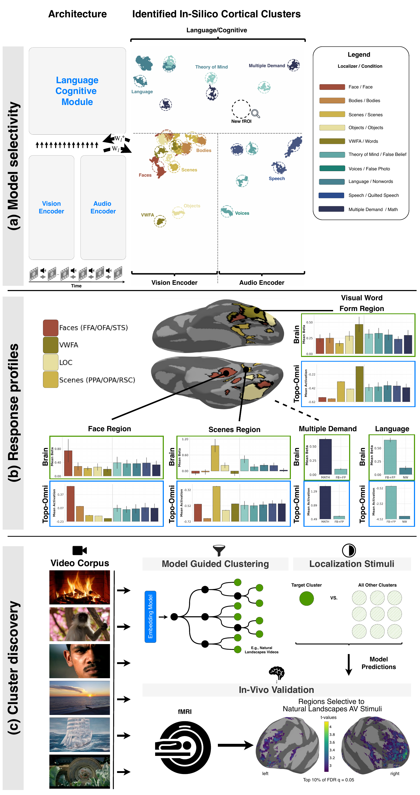

# Topo-Omni: Discovering Functionally Selective Brain Regions with a Deep Topographic Multimodal Model

[](https://arxiv.org/abs/2606.09770)
[](https://topo-omni.epfl.ch)
[](https://huggingface.co/epfl-neuroai/topo-omni)




Inducing topographic organization in a multimodal language model (Qwen2.5-Omni) using a spatial smoothness loss inspired by biological cortical maps.

The model learns a 2-D *cortical sheet*, a fixed spatial layout of neurons shared across all transformer layers, and is trained to encourage nearby neurons to respond similarly. The result is emergent functional regions (face patches, scene areas, auditory regions) that spatially cluster on the sheet, mirroring organization in the human brain.

---

## Overview

Standard neural networks have no spatial structure: any neuron can interact with any other regardless of position. The brain, by contrast, organizes neurons topographically: neurons with similar tuning are physically close. TopoOmni injects this inductive bias into Qwen2.5-Omni-3B by:

1. Assigning every neuron in the network a fixed 2-D coordinate on a shared cortical sheet.
2. Adding a spatial loss term during training that penalizes nearby neurons for responding dissimilarly.
3. Evaluating the learned sheet for selectivity (face/scene/object/body areas), brain alignment (NSD), and causal intervention (ablation/stimulation).
4. Discovering new functionally selective clusters and validating it on a heldout brain dataset (SpaceTop fMRI).

The approach builds on [TDANN](https://github.com/neuroailab/TDANN) and [TopoLM](https://topolm.epfl.ch).

---

## Repository Structure

```
topo-omni/
├── make_all_figures.py          # orchestrator: reproduce all model-side figures (precomputed|raw)
├── download_precomputed.py      # fetch the precomputed cut from OSF (+ sha256 verify)
├── .env.example                 # environment template (copy to .env)
├── src/
│   │                             # Shared library first, then one folder per experiment.
│   ├── core/
│   │   ├── model_loading.py      # load_topo_omni(): single HuggingFace/local model loader
│   │   └── precomputed.py        # OSF cut fetch + sha256 verify
│   ├── models/
│   │   ├── qwen2_5_omni.py       # Modified Qwen2.5-Omni with cortical sheet output
│   │   └── spatial_utils.py      # LayerPositions, spatial loss, neighborhood utilities
│   ├── utils/                    # Sheet-generic numerics, shared across experiments
│   │   ├── smoothing.py          # Gaussian smoothing over the cortical sheet
│   │   ├── spatial_stats.py      # Selectivity / spatial-statistics helpers
│   │   ├── connected_components.py
│   │   └── island_morans_I.py    # Spatial autocorrelation (Moran's I) for patchy maps
│   ├── training/                 # Everything needed to TRAIN a model (run from src/)
│   │   ├── train.py              # Training entry point
│   │   ├── distill.py            # Knowledge distillation entry point
│   │   ├── init_coords.py        # Pre-compute cortical coords / neighborhood structures
│   │   ├── data_utils.py         # Dataset loading and collation
│   │   └── batching.py           # Modality-homogeneous batch sampler
│   ├── configs/
│   │   ├── accelerate.yml        # Accelerate/DeepSpeed launcher config
│   │   ├── init/                 # Cortical coordinate initialization (coords*.yml)
│   │   ├── train/                # Training configs (base.yml, tiled32_4608.yml, ...)
│   │   ├── eval/                 # Eval configs (retinotopy.yml, tonotopy.yml, marvi.yml, ...)
│   │   └── experiments/          # One-off variants of the above, one per evaluation actually
│   │                             # run (per checkpoint, fwhm, layout or control); same init/train/eval split
│   ├── experiments/              # ONE FOLDER PER EXPERIMENT — each holds the whole chain
│   │   │                         # (extract → run → analyse → plot) for that phenomenon.
│   │   ├── orientation/          # Orientation maps, pinwheels, column spacing (Lambda)
│   │   │   ├── run.py            #   map orientation preference over the sheet
│   │   │   ├── metrics.py        #   preferred orientation, OSI, pinwheel detection
│   │   │   ├── reference.py      #   reference-map construction
│   │   │   ├── measure_lambda.py #   column spacing per vision-encoder tile
│   │   │   ├── pinwheel_null.py  #   pinwheel count vs shuffled null
│   │   │   ├── pinwheel_scan.py  #   scan slot ranges for pinwheel excess
│   │   │   ├── plot_panel.py     #   paper panel: smoothed orientation map
│   │   │   ├── plot_tiled.py     #   per-slot maps for a tiled sheet
│   │   │   ├── plot_map_sf_color.py  # spatial-frequency and colour preference maps
│   │   │   ├── plot_density_bars.py
│   │   │   ├── smoothness_panels.py, smoothness_window_scan.py
│   │   │   ├── tangential_ratio.py, nn_delta.py, deep_band_continuous.py
│   │   │   └── macaque_map.py, tdann_model.py   # macaque V1 + TDANN references
│   │   ├── retinotopy/
│   │   │   ├── stimuli.py        #   localized stimulus bank (self-generating)
│   │   │   ├── run.py            #   retinotopic mapping
│   │   │   └── run_angle.py, run_ecc.py         # polar angle / eccentricity
│   │   ├── tonotopy/
│   │   │   ├── stimuli.py        #   pure-tone stimulus bank
│   │   │   ├── run.py            #   tonotopic mapping
│   │   │   └── plot.py
│   │   ├── selectivity/          # Category selectivity over the sheet
│   │   │   ├── extract_features.py  # model responses to localizer stimuli
│   │   │   ├── run.py            #   ON vs OFF t-contrast, FDR-corrected
│   │   │   ├── plot.py           #   in-silico selectivity sheet (all localizers)
│   │   │   ├── plot_category.py  #   one localizer's t-map with its top islands
│   │   │   ├── island_null.py    #   depth-corrected island scores (label-permutation null)
│   │   │   └── topo_nontopo.py, topo_nontopo_clustering.py  # topo vs non-topo controls
│   │   ├── response_profiles/    # Per-category response bars (model vs fMRI localizers)
│   │   │   ├── cognitive.py, marvi.py           # compute profiles
│   │   │   ├── plot.py, plot_cognitive.py, plot_pernet.py
│   │   │   └── plot_fmri.py      #   the human ROI profiles, in the same style
│   │   ├── ablation/             # Causal tests: ablation + stimulation
│   │   │   ├── run.py            #   ablate a sheet region, measure behaviour
│   │   │   ├── plot.py, plot_barplot.py
│   │   │   ├── similarity.py, no_ablation_judge.py
│   │   │   └── stimulation_perception.py, driving_perception.py
│   │   ├── spacetop_discovery/   # Model-guided discovery of novel networks (SpaceTop)
│   │   │   ├── extract.py, extract_rating.py
│   │   │   ├── contrast.py       #   cluster contrasts
│   │   │   ├── run_clusters_iou.py, explore_cluster_iou.py   # IoU vs null
│   │   │   ├── plot_selectivity.py, plot_corr.py
│   │   │   ├── correlate_t_values.py            # model vs fMRI t-maps
│   │   │   │                     # unsupervised discovery chain (was topo-discover/):
│   │   │   ├── extract_video_embeddings.py, compile_embeddings.py   # per-clip embeddings
│   │   │   ├── agglomerative_early_stopping.py, merge_clusters.py,  # cluster
│   │   │   │   plot_dendrogram.py
│   │   │   ├── create_cluster_manifest.py, calculate_selectivity.py, # label + inspect
│   │   │   │   plot_model_selectivity.py, make_cluster_collages.py,
│   │   │   │   sample_cluster_frames.py
│   │   │   ├── residualize_movie.py, modality_sheets.py       # controls: movie identity, input stream
│   │   │   │                     # after discovery (see "Cluster discovery" below):
│   │   │   ├── cluster_maps.py, cluster_null.py               # cluster maps + depth-corrected null
│   │   │   ├── cluster_fingerprint.py, cluster_roi_mean_t.py  # cluster vs localizer regions (model)
│   │   │   ├── brain_fingerprint.py, brain_roi_mean_t.py,     # cluster vs EMFL ROIs (fMRI)
│   │   │   │   brain_roi_subject_test.py, brain_global_removed_group.py,
│   │   │   │   cluster_surface_report.py
│   │   │   └── model_brain_roi_mean_t.py, model_brain_roi_mean_t_subject.py  # model vs brain
│   │   └── brain_alignment/      # Encoding-model alignment to human fMRI
│   │       ├── plot_barplot.py
│   │       └── table.py, table_stats.py
│   ├── tools/                    # Dev/preflight utilities (not part of the paper pipeline)
│   ├── ckpts -> ../artifacts/ckpts              # symlinks; real dirs live in artifacts/
│   ├── neighborhoods -> ../artifacts/neighborhoods
│   └── wandb -> ../artifacts/wandb
├── artifacts/                    # Gitignored run outputs: checkpoints, neighborhoods, wandb logs
├── scripts/                      # Shell launchers, batch sweeps, result-compilation utilities
│   ├── reproduce_precomputed_figures.sh  # one-command precomputed reproduction
│   ├── train.sh
│   ├── run_ablation.sh
│   ├── run_iou.sh
│   ├── marvi_response_profiles.sh
│   ├── cognitive_response_profiles.sh
│   ├── pernet_response_profiles.sh
│   ├── plot_spacetop.sh
│   ├── compile_iou.py
│   ├── compile_moran_I.py
│   ├── run_selectivity.py        # Batch launcher for selectivity sweeps
│   ├── submit_train.py
│   ├── submit_topoomni_ablation.sh
│   ├── submit_topoomni_spacetop_discovery.sh
│   ├── submit_topoomni_stimulation.sh
│   ├── submit_taskonly_training.sh     # matched task-only control (tiled32; 4x H200)
│   ├── submit_taskonly_selectivity.sh  # selectivity maps of that control
│   ├── submit_baseline_selectivity.sh  # selectivity maps of the untrained Qwen2.5-Omni-3B
│   ├── submit_early_topography.sh      # retinotopy + orientation on the tiled32 run
│   ├── submit_nsd_features.sh          # NSD feature extraction, sharded over GPUs
│   └── figures/                  # Scripts that reproduce individual paper figures
├── data/                         # Small tracked artifacts (summary CSVs, figures);
│                                 # large stimuli/checkpoints/datasets are gitignored
├── fMRI/                         # ⚠ SEPARATE SUBPROJECT — brain-side, not the model.
│                                 # Reanalyzes the 3 human-fMRI datasets (Pernet/Marvi/Jung) to
│                                 # reproduce the paper's brain figures from a precomputed OSF cut.
│                                 # Own Nilearn stack + per-dataset envs (no torch/transformers);
│                                 # shares dataset names with src/ but no data or code. See below.
├── requirements.txt
└── README.md
```


### Where each figure's code lives

Each paper figure is reproduced by one script in `scripts/figures/`, which shells out to the
experiment folders under `src/experiments/`. To follow a figure back to its source, start here:

| Figure | Reproduce with | Experiment folder(s) |
|--------|----------------|----------------------|
| 1a | `scripts/figures/figure_1a.py` | `experiments/selectivity/` — unified sheet, tiled32 run |
| 2c | `scripts/figures/figure_2.py` | `experiments/spacetop_discovery/` |
| 3 | `scripts/figures/figure_3.py` | `experiments/selectivity/`, `experiments/response_profiles/`, `experiments/retinotopy/` |
| 4 | `scripts/figures/figure_4.py` | `experiments/tonotopy/`, `experiments/response_profiles/` |
| 5 | `scripts/figures/figure_5.py` | `experiments/response_profiles/` |
| 6 | `scripts/figures/figure_6.py` | `experiments/ablation/` |
| 7 | `scripts/figures/figure_7.py` | `experiments/spacetop_discovery/` |

Figure 1a is the only figure built on the `topo-omni-tiled32-4608` run (800x576 sheet); every
other figure uses the default `topo-omni` strip model. Its selectivity stats are the one expensive
input: 10 localizers x a model load each. Either run them sequentially

```bash
python scripts/run_selectivity.py --model_name topo-omni-tiled32-4608 --fwhm 3.0
```

or restrict it to a subset of localizers:

```bash
python scripts/run_selectivity.py --model_name topo-omni-tiled32-4608 --fwhm 3.0 \
    --conditions faces,scenes
```

To fan out across the cluster instead, submit that same command once per localizer as
its own single-GPU runai job (A100 `default` pool) — no wrapper script ships with
the repo. `run_selectivity.py` tags each job's transient eval config with a uuid, so
concurrent jobs sharing the NFS checkout cannot clobber one another's config.

Both write `results/topo-omni-tiled32-4608/<localizer>/<localizer>_fwhm3.0_selectivity_stats.pkl`,
which is what `scripts/figures/figure_1a.py` reads.

Supporting analyses that are not a single main-text figure live in
`experiments/orientation/` (orientation maps, pinwheels, column spacing) and
`experiments/brain_alignment/` (encoding-model alignment tables).

Every experiment folder holds the **whole chain** for that phenomenon — feature extraction,
the run/eval step, post-hoc analysis, and plotting — so nothing has to be traced across
`run/`, `extract/`, `analysis/`, and `visualize/` directories any more.

---

## Cortical Sheet

The cortical sheet is a **304 × 512** 2-D grid that spans the entire model:

| Rows | Component |
|------|-----------|
| 0 – 159 | Vision encoder layers |
| 0 – 159 (cols 256–511) | Audio encoder layers |
| 160 – 303 | Thinker (LM) layers |

Each unit (neuron) has a fixed coordinate on this grid. The spatial loss computes pairwise response similarity within local Chebyshev-distance neighborhoods and penalizes dissimilarity between neighbors. The loss weight `alpha` (default: 20) controls how strongly the spatial constraint is applied relative to the task loss.

### The tiled32 sheet (`topo-omni-tiled32-4608`)

The revised analyses use a second layout, selected with `TOPO_SHEET_LAYOUT=tiled32`: an
**800 × 576** sheet (460,800 units) on which every layer is its own tile of 4,608 units
(`cortical_dim: 4608`), 32 tiles per encoder and 36 for the thinker, laid out in serpentine
order so that consecutive layers stay adjacent. It has no front-end (conv / patch-embed)
slot, and its spatial loss has two terms, a fine one at a constant radius and a coarse one
whose radius grows with encoder depth (`tiled32_4608.yml`).

**`TOPO_SHEET_LAYOUT` must match the checkpoint for every script that loads it, inference
included.** The layout is read at import time. Loading a tiled32 checkpoint without it builds
the strip layout's front-end adaptors, which are absent from the checkpoint and are applied at
random initialization. The only sign is Hugging Face's "newly initialized" warning; treat it as
a failure. Scripts that place units on the sheet also need the coordinates the run was trained
with (`stats.coords_path` in the eval configs under `src/configs/experiments/eval/`), and stop
if their unit count disagrees with the layout.

---

## Setup

```bash
pip install -r requirements.txt
```

Copy `.env.example` to `.env` at the repo root (loaded via `python-dotenv`) and fill in the paths
you need. **For the default figure-reproduction path (precomputed) you need none of them** — only
`SAVE_DIR` (where the downloaded cut lands) is used, and the reproduce script sets it for you. The
other paths matter only for the `raw` recompute path and for training. The trained model is loaded
from HuggingFace (`epfl-neuroai/topo-omni`) by default, so no checkpoint download is required.

---

## System requirements

**Operating system.** Developed and tested on Ubuntu Linux 22.04 (x86_64).
The code is standard cross-platform Python but has only been tested on Linux.

**Python.** Python 3.10.

**Software dependencies.** All Python dependencies, with pinned versions, are listed in
[`requirements.txt`](requirements.txt) and installed with the command in [Setup](#setup). Key packages:
`torch`, `transformers`, `trl`, `accelerate`, `deepspeed`, `qwen_omni_utils`, `omegaconf`, `wandb`,
plus `numpy`, `scipy`, `scikit-learn` and `matplotlib`. The brain-side [`fMRI/`](fMRI/) subproject has
its own separate Nilearn-based environment (see [`fMRI/README.md`](fMRI/README.md)).

**Tested on.** Ubuntu Linux, Python 3.10, with the package versions pinned in `requirements.txt`.

**Typical install time.** A few minutes on a normal desktop (~5–15 minutes), dominated by downloading the PyTorch / CUDA wheels.

**Hardware.**
- *Precomputed figure reproduction (default path):* **no GPU required** — runs on a standard CPU
  desktop/laptop.
- *Raw recompute / training:* one or more CUDA-capable NVIDIA GPUs.
  The model was trained on 4× H200 --> Training uses multi-GPU via `accelerate` + `deepspeed`.

No other non-standard hardware is required.

---

## Reproducing the paper figures

The model-side figure panels (Fig 2b/c, 3, 4, 5, 6, 7) reproduce via **two clearly separated
paths**, mirroring the brain-side [`fMRI/`](fMRI/) subproject — see [`docs/DESIGN.md`](docs/DESIGN.md)
for the rationale and a per-panel input-availability table.

**1. Precomputed (default, recommended)** — plot from a hosted cut of model outputs. No GPU, no
stimuli, no model download.

```bash
./scripts/reproduce_precomputed_figures.sh            # download cut from OSF + render all figures
./scripts/reproduce_precomputed_figures.sh 3 4        # a subset

# …or the two steps by hand:
python download_precomputed.py --dest _precomputed_cut
python make_all_figures.py --input-source precomputed --derivatives-root _precomputed_cut
```

Panels land in `figures_out/figure_<id>/`.

> **This precomputed path also serves as the demo** required by the software checklist. It runs on a
> small hosted cut of model outputs (downloaded from OSF), needs no GPU, no stimuli and no model download.
> - **Demo dataset:** the precomputed cut fetched by `download_precomputed.py` from OSF
>   (DOI [10.17605/OSF.IO/EHRT6](https://doi.org/10.17605/OSF.IO/EHRT6)).
> - **Expected output:** rendered panels written to `figures_out/figure_<id>/`
>   (e.g. `figures_out/figure_3/`).
> - **Expected run time:** roughly ~5 minutes on a normal desktop for the full set
>   (less for a subset such as `./scripts/reproduce_precomputed_figures.sh 3 4`).

**2. Raw (opt-in)** — download the model from HuggingFace and recompute from stimuli (needs a GPU).
Fully wired where inputs are public (the retinotopy/tonotopy stimulus banks self-generate); panels
whose localizer stimuli aren't redistributable read from a `STIMULI_DIR` you supply.

```bash
python make_all_figures.py --input-source raw --derivatives-root results --figures 3,4
```

Everything below documents the individual building blocks these two paths orchestrate.

---

## Usage

Evaluation / figure commands are run from the **repo root** (module form, e.g.
`python -m src.experiments.<topic>.<script>`). The **training** commands (steps 1–2) are run from inside `src/`.

### 1. Initialize cortical coordinates *(training only)*

Pre-computes neighborhood structures for the spatial loss. Run once before training.

```bash
cd src && python training/init_coords.py --config configs/init/coords.yml
```

This generates `.pkl` files under `src/neighborhoods/` (a symlink to `artifacts/neighborhoods/`) keyed by model name, radius, and neighborhood count.

### 2. Train *(training only)*

```bash
cd src && bash ../scripts/train.sh train/base.yml <num_gpus> accelerate.yml
```

Key config options (`configs/train/base.yml`):

| Key | Default | Description |
|-----|---------|-------------|
| `train.apply-spatial-loss` | `true` | Enable the topographic loss |
| `topo-params.alpha` | `20` | Spatial loss weight |
| `topo-params.position-dir` | `neighborhoods/...` | Pre-computed neighborhood directory |
| `topo-params.cortical-init` | `0.001` | Cortical output projection init scale |
| `topo-params.identity-init` | `true` | Initialize output projection as identity |
| `train.n-epochs` | `5` | Training epochs |
| `train.batch-size` | `4` | Per-device batch size |
| `train.grad-accum` | `4` | Gradient accumulation steps |
| `train.learning-rate` | `5e-5` | Learning rate |

Training logs to Weights & Biases when `--wandb` is passed.

**Task-only control.** `scripts/submit_taskonly_training.sh` trains
`topo-omni-tiled32-4608-taskonly`, whose config differs from the topographic run only by
`apply-spatial-loss: false`. It resumes automatically from the highest `checkpoint-*` in the
run directory. To match the topographic run's effective batch (3 × 5 × 4 = 60) it needs exactly
4 GPUs with at least 140 GiB each (H200). Do not schedule it on B300: the container's
nvrtc cannot compile for Blackwell, and runai reports that crash as *Succeeded*.

### 3. Run selectivity evaluation

Tests whether specific regions on the cortical sheet are selective for a category (faces, bodies, objects, scenes, speech, etc.) versus control stimuli.

```bash
python -m src.experiments.selectivity.run --config src/configs/eval/marvi.yml
```

The model is loaded from HuggingFace (`epfl-neuroai/topo-omni`) by default; set `$TOPO_OMNI_MODEL`
or `model.model` in the config to use a local checkpoint instead.

Key config options (`src/configs/eval/marvi.yml`):

| Key | Description |
|-----|-------------|
| `model.model` | *(optional)* HF id or local checkpoint dir (default: `$TOPO_OMNI_MODEL`) |
| `data.mode` | `video`, `image`, or `text` |
| `data.stimuli_root` | Path to ON/OFF stimuli folders |
| `data.lm_reduce` | Reduction over LM sheet (`mean`/`max`) |
| `stats.alpha` | p-value threshold for selectivity |
| `stats.smooth` | Apply Gaussian smoothing before testing |
| `stats.fwhm_mm` | Smoothing kernel FWHM (mm) |

`scripts/run_selectivity.py` runs the whole localizer sweep for one run. `--checkpoint`
selects the weights (default: the highest-numbered `checkpoint-*` in the run directory);
`--model_name` names both the run directory and the output directory.

```bash
TOPO_SHEET_LAYOUT=tiled32 python scripts/run_selectivity.py \
    --model_name topo-omni-tiled32-4608 --checkpoint checkpoint-730 --fwhm 3.0

# the untrained Qwen2.5-Omni-3B with identity adaptors, on the same sheet geometry
TOPO_SHEET_LAYOUT=tiled32 python scripts/run_selectivity.py \
    --baseline --config_from topo-omni-tiled32-4608 --model_name qwen-omni-base-tiled32 --fwhm 3.0
```

The sweep includes the verbs-versus-nouns negative control of Moseley & Pulvermüller (2014)
(`moseley_{concrete,abstract}_{verbs,nouns}`). `submit_taskonly_selectivity.sh` and
`submit_baseline_selectivity.sh` submit one runai job per localizer for the two controls.

**Choosing which islands to draw.** Deeper layers have a larger spatial-loss radius, so their
islands are large whatever the contrast. `selectivity/island_null.py` shuffles each localizer's
ON/OFF labels, records the chance-island size in every tile, and scores each observed island
by its depth-corrected mass, (size / chance size at that depth) × mean t, with a family-wise
p-value. `plot.py` and `plot_category.py` then rank islands by it with
`--island-rank corrected`:

```bash
python -m src.experiments.selectivity.island_null \
    --results-dir results/topo-omni-tiled32-4608 --stats-suffix _fwhm3.0 --coords <training coords.npy>
python -m src.experiments.selectivity.plot_category --results-dir results/topo-omni-tiled32-4608 \
    --category faces --stats-suffix _fwhm3.0 --top-k-pct 10 --n-islands 3 --island-rank corrected \
    --island-scores results/topo-omni-tiled32-4608/faces/faces_fwhm3.0_island_null.json
```

### 4. Ablation and stimulation

Ablates (zeros out) or stimulates (amplifies) a localizer-defined region and measures the effect on downstream responses.

```bash
bash scripts/run_ablation.sh
```

### 5. Brain alignment

Extract model activations for NSD (images) or SpaceTop (videos) fMRI datasets, then compare the topographic layout to human brain responses.

```bash
# NSD
python -m src.experiments.selectivity.extract_features \
    --model_name topo-omni-tiled32-4608 --checkpoint artifacts/ckpts/topo-omni-tiled32-4608

# SpaceTop
python -m src.experiments.spacetop_discovery.extract --group-index 0
```

For NSD, the unit masks come from the run's own selectivity stats
(`<model_name>/<cat>/<cat>_fwhm3.0_selectivity_stats.pkl`; `--stats_fwhm_mm none` reads the
older `_all_` files), so the selectivity sweep has to exist first. Pass `--checkpoint`: without
it the model falls back to `$TOPO_OMNI_MODEL` while `--model_name` still names the output, so
features of one run would be saved under another's name. `--baseline` extracts with the
untrained Qwen2.5-Omni-3B instead.

The 73,000 images are written in 286 self-contained batches of 256. A rerun skips batches
already on disk, and `--start_batch` / `--end_batch` split the work across jobs;
`scripts/submit_nsd_features.sh` does that over `NUM_SHARDS` GPUs (default 8). Keep the
ranges disjoint, because the skip check is not a lock.

Run correlation analysis:

```bash
python -m src.experiments.spacetop_discovery.contrast --cluster_id 32 --topk 1
```

### 6. Response profiles

Compute and plot how the top-k% most selective neurons respond across all stimulus categories. Separate sweeps are provided per localizer family:

```bash
bash scripts/marvi_response_profiles.sh [top_k_pct] [fwhm_mm] [anatomical_constraint]      # faces, scenes, objects, vwfa, bodies, speech
bash scripts/cognitive_response_profiles.sh [top_k_pct] [fwhm_mm]                          # language, theory of mind, multiple demand
bash scripts/pernet_response_profiles.sh [top_k_pct] [fwhm_mm] [anatomical_constraint]     # PerNet vocal/non-vocal folds
```

These call into `experiments/response_profiles/marvi.py` / `experiments/response_profiles/cognitive.py` and plot via `experiments/response_profiles/plot.py`, `experiments/response_profiles/plot_cognitive.py`, and `experiments/response_profiles/plot_pernet.py`.

`experiments/response_profiles/plot_fmri.py` draws the matching human profiles from the
Marvi ROI summary CSV (group mean ± SEM across subjects). It imports the palette and condition
order from `plot.py`, so the model and brain panels cannot drift apart. All figure scripts share
one muted, two-family palette (warm for the five visual categories, cool for the auditory and
text ones), defined in `selectivity/plot.py`.

### 7. Retinotopy and tonotopy mapping

Map preferred visual-field position (eccentricity / polar angle) and preferred sound frequency across the cortical sheet, masking units that fail an ANOVA tuning test (FDR-corrected). The stimulus banks **self-generate** (no data download), which makes these panels fully reproducible on the raw path with only a GPU:

```bash
# 1. generate the (public) stimulus banks into $STIMULI_DIR
python -m src.experiments.retinotopy.stimuli     # -> $STIMULI_DIR/retino_bank/{*.png, manifest.csv}
python -m src.experiments.tonotopy.stimuli    # -> $STIMULI_DIR/tone_bank/{*.wav, manifest.csv}

# 2. run the model over them (produces the maps directly)
python -m src.experiments.retinotopy.run --config src/configs/eval/retinotopy.yml   # polar angle + eccentricity
python -m src.experiments.tonotopy.run   --config src/configs/eval/tonotopy.yml     # preferred frequency
```

(The single-axis variants `retinotopy/run_ecc.py` / `retinotopy/run_angle.py` expect `eccentricity/` and `angle/` sub-banks instead of the combined `retino_bank`.)

All three retinotopy scripts take the unit coordinates (`stats.coords_path`) and the smoothing
(`stats.fwhm_mm`) from the config. They stop if the coordinates do not match the active sheet
layout, and they crop to the vision encoder of that layout. For the tiled32 run use
`src/configs/experiments/eval/retinotopy_tiled32_ckpt730.yml`;
`scripts/submit_early_topography.sh` submits the angle, eccentricity and orientation jobs for it.

The same masked-map treatment is available for **orientation preference**, using one of TDANN's two public sine-grating banks, selected with `data.bank`: `ori_bias` (the default; cardinal orientations oversampled) or `unbiased` (TDANN's published set: 8 orientations × 8 spatial frequencies × 5 phases × {bw, rg} = 640 full-field gratings), which the tiled32 configs use. Neither bank is self-generating, but both are public, so the script downloads the chosen one from OSF on first run — no manual staging:

```bash
python -m src.experiments.orientation.run --config src/configs/eval/orientation.yml
```

> **Known issue:** the OSF folder listing is paginated and not stably ordered. A file can
> appear on two pages while another is never listed, and the downloader removes duplicates
> without checking the total, so it can finish a file or two short without an error.
> The existing local copies hold 638 of the 640 unbiased gratings and 510 of the 511
> orientation-bias ones. Compare the count in `manifest.csv` with OSF's total before relying
> on a fresh download.

It writes a preferred-orientation map (cyclic colormap), an orientation-selectivity-index (OSI) map, a scatter over the whole sheet, and a histogram of preferred orientations against the bank's own orientation distribution. Each unit's opacity encodes how strongly it is tuned, so marginal units fade into the background instead of being shown or hidden by a flat pass/fail mask.

`stats.criterion` selects what "tuned" means — all three are computed and saved every run, so switching only re-renders the figures:

| criterion | statistic | default cutoff |
|-----------|-----------|----------------|
| `reliability` (default) | correlation between tuning curves from two halves of the stimuli, split *along* a nuisance dimension (`stats.reliability_split`: `sf`, `phase`, `colour`, `random`) | 0.5 |
| `eta2` | fraction of the unit's response variance explained by orientation | 0.10 |
| `fdr` | FDR-corrected ANOVA p-value | `stats.alpha` |

**Prefer `reliability` or `eta2` over `fdr`.** A p-value needs an absurd threshold here (~1e-50) to be selective, and the multiple-comparisons correction is not the reason: measured on this sheet, the whole span from uncorrected *p* to Bonferroni is 5.2 orders of magnitude — necessarily log10 of the 155,648 tests — so no correction moves the threshold far, and even Bonferroni still leaves ~82% of the vision band significant at 0.05. What actually inflates *p* is (i) the model being deterministic, so the ANOVA's error term is nuisance variance rather than trial noise and "the orientation effect is exactly zero" is essentially never true, and (ii) running the test on the *smoothed* sheet, worth ~13 orders of magnitude at the median (49% → 99% of the band significant) because near-silent units inherit their neighbours' tuning. Corrections that model the smoothing-induced dependence (RFT, cluster permutation) make the threshold *more* lenient, not less. A tiny alpha is an effect-size filter in disguise, so use an effect size.

To quantify the resulting map with the metrics TDANN reports for V1 (Margalit et al.,
Fig. 2 / `notebooks/F02_V1_Details`):

```bash
python -m src.experiments.orientation.metrics
```

This reads the `orientation_stats.npz` the run above wrote — no GPU, no re-extraction — and
reports **circular variance** (`CV = 1 - |R|`, identical to `1 - OSI`), **column spacing**
`Λ` (from the peak of the radially averaged power spectrum of `exp(2iθ)`; TDANN hard-codes
this per model, we estimate it), **pinwheel density** in pinwheels per `Λ²` (winding numbers
over the smoothed map, then connected-component counting — dimensionless, so comparable to
TDANN's ~2.1 and macaque V1's ~3.0), and **map smoothness** (`(max - first) / max` of the
Δ-preferred-orientation-vs-distance curve).

The smoothness panels for orientation, spatial frequency and colour (Δ preference against
distance, and smoothness bars for Topo-Omni, its controls, TDANN and macaque V1) come from
`orientation/smoothness_panels.py`. `--bar-models` and `--line-models` choose which models are
drawn, while the saved statistics always cover all of them. `orientation/plot_map_sf_color.py`
draws the sheet maps of preferred spatial frequency and colour that go with `plot_panel.py`'s
orientation map. `plot_panel.py --no-counts` and `plot_tiled.py --no-counts` keep the pinwheel
markers but leave the counts out of the figure.

Two caveats it prints and you should not skip:

* **Pinwheel density is strongly smoothing-dependent** — it varies by two orders of magnitude
  as the smoothing window grows from 0.15Λ to 1.0Λ, because a window approaching Λ averages
  away the 180° turn at a pinwheel. The script always prints the full sensitivity sweep;
  never quote a density without stating the window. The default (`--smooth-window-frac 0.15`)
  keeps ~16 px per Λ, and the script warns below 8 px per Λ.
To compare the map against the reference data TDANN uses:

```bash
python -m src.experiments.orientation.reference
```

**The reference is macaque V1, not human.** TDANN's Fig. 2 compares against macaque
optical-imaging maps (Nauhaus) and macaque single units (Ringach et al. 2002); human V1
orientation columns have never been mapped at pinwheel resolution, so there is no human
reference for these metrics. (The human fMRI data under [`fMRI/`](fMRI/) is category
selectivity, not orientation, and cannot substitute.)

Two reference curves are reconstructed rather than read off a figure:

* **Circular variance** — `data/ringach_2002_db.mat` (shipped by TDANN) holds the real
  per-neuron values, so the script runs an actual two-sample KS test.
* **Δorientation vs. distance** — `experiments/orientation/macaque_map.py` reproduces TDANN's
  `NauhausOrientationTissue`, which is *not* a data file: it colour-decodes the orientation
  panel of Fig. 2 of Nauhaus et al. (2012, Nat Neurosci 15:1683) against that panel's own
  legend, and scales pixels to mm with its scale bar. Our reconstruction yields macaque
  smoothness **0.684** against TDANN's published ~0.65, which validates the port. The source
  figure is copyrighted, so it is fetched on demand and gitignored; only the derived curve
  (`data/macaque_delta_curve.npz`) is tracked.

**Smoothness is not parameter-free.** It depends both on the smoothing fwhm used to build the
map (0.730 at fwhm=4 vs 0.466 at fwhm=2 on this sheet — straddling macaque's 0.684) and on the
distance binning, since `(max - curve[0]) / max` moves with the width of the first bin. The
metrics script therefore uses TDANN's own binning (9 bins reaching 0.943·Λ), and only values
computed at matched fwhm *and* matched bins should be compared.

Pinwheel density and the remaining panel values are still TDANN's Fig. 2 compares against macaque
optical-imaging maps (Nauhaus) and macaque single units (Ringach et al. 2002); human V1
orientation columns have never been mapped at pinwheel resolution, so there is no human
reference for these metrics. (The human fMRI data under [`fMRI/`](fMRI/) is category
selectivity, not orientation, and cannot substitute.) Circular variance is a genuine
quantitative comparison — `data/ringach_2002_db.mat` ships the real per-neuron values, so
the script runs an actual two-sample KS test. Pinwheel density and smoothness references are
**read off the published figure** and labelled approximate, because TDANN does not
redistribute the macaque map data they come from.

* **The vision band's row axis is depth**, not tangential cortex (32 layers × 5 rows), so `Λ`
  and pinwheel density are not straightforwardly the V1 quantities. The script quantifies how
  badly this bites: the map's anisotropy, and whether neighbouring rows are more alike within
  a layer than across a layer boundary.

For `reliability`, use a **structured** split rather than `random`: random halves draw the same mixture of nuisance stimuli and so only measure sampling noise — a unit whose preferred orientation shifts 45° between low and high spatial frequency still scores r ≈ 0.97. Splitting along `sf` instead asks whether the preference survives a change in spatial frequency, and on this sheet that drops median vision-band reliability from 0.87 to 0.58. Preference and OSI come from the circular (axial, mod-180°) vector average of each unit's tuning curve. Note the bank deliberately oversamples cardinal orientations (0°: 79 stimuli, 90°: 80, vs 45°: 47, 135°: 48); responses are averaged *within* each orientation before that vector average, which keeps the sampling bias out of the estimate (taking it over the raw stimuli instead shifts preferences by up to ~4°). The histogram overlay is what separates a genuine cardinal preference in the sheet from the bank's sampling bias.

### 8. Cluster IoU

Measure the spatial overlap (IoU) of thresholded activation masks across stimulus groups, with a random-sampling null distribution for significance.

```bash
bash scripts/run_iou.sh
```

---

## Evaluation metrics

| Metric | Script | Description |
|--------|--------|-------------|
| Selectivity (t-test) | `experiments/selectivity/run.py` | ON vs OFF contrast, FDR-corrected |
| Moran's I | `utils/island_morans_I.py` | Spatial autocorrelation of the selectivity map |
| Brain alignment (r) | `experiments/spacetop_discovery/contrast.py` | Correlation with fMRI t-maps |
| Ablation accuracy | `experiments/ablation/similarity.py` | Cross-category response similarity under ablation |
| Cluster IoU | `experiments/spacetop_discovery/run_clusters_iou.py` | Overlap of activation masks across groups |
| Retinotopic tuning | `experiments/retinotopy/run*.py` | Preferred eccentricity/polar-angle per unit, ANOVA-tested |
| Tonotopic tuning | `experiments/tonotopy/run.py` | Preferred sound frequency per unit, ANOVA-tested |
| Orientation tuning | `experiments/orientation/run.py` | Preferred orientation + OSI per unit (circular, mod-180°), ANOVA-tested |
| Orientation map structure | `experiments/orientation/metrics.py` | Circular variance, column spacing, pinwheel density, map smoothness (TDANN Fig. 2 metrics) |
| Orientation map vs. macaque | `experiments/orientation/reference.py` | KS of circular variance against Ringach 2002 macaque V1 (n=308) |
| Macaque reference map | `experiments/orientation/macaque_map.py` | Reconstructs TDANN's macaque orientation map to overlay its Δorientation-vs-distance curve |
| Feature-map smoothness | `experiments/orientation/smoothness_panels.py` | Δ preference vs distance and smoothness for orientation, spatial frequency and colour, against TDANN and macaque V1 |
| Depth-corrected island score | `experiments/selectivity/island_null.py`, `experiments/spacetop_discovery/cluster_null.py` | Island size relative to chance islands in the same layer, × mean t; family-wise p from a permutation null |
| Cluster vs localizer regions | `experiments/spacetop_discovery/cluster_roi_mean_t.py`, `cluster_fingerprint.py` | Mean cluster t (or spatial r) in each localizer region of the model sheet |
| Cluster vs human ROIs | `experiments/spacetop_discovery/brain_roi_subject_test.py`, `model_brain_roi_mean_t_subject.py` | Subject-level tests of cluster responses in the EMFL ROIs, and model–brain correlation across clusters |

---

## Cluster discovery

`src/experiments/spacetop_discovery/` runs an unsupervised pipeline to find functionally selective clusters from video-driven activations: extract per-clip embeddings (`extract_video_embeddings.py`, `compile_embeddings.py`), agglomeratively cluster them (`agglomerative_early_stopping.py`, `plot_dendrogram.py`, `merge_clusters.py`), then label and inspect the resulting clusters (`create_cluster_manifest.py`, `calculate_selectivity.py`, `plot_model_selectivity.py`, `make_cluster_collages.py`).

**Clips.** `extract_video_embeddings.py` now cuts each movie into non-overlapping 2 s clips by
default (`--chunk-mode disjoint`). The original run's clips were cumulative prefixes of the movie
(clip *N* = its first 2(*N*+1) s), so consecutive clips overlapped almost entirely and the tree
grouped clips by movie; `--chunk-mode prefix` reproduces that run. `--run_tag` keeps runs of the
same checkpoint over different clip sets in separate output directories
(`spacetop_discovery_<tag>`). `residualize_movie.py` regresses movie identity out of the
embeddings before clustering, and its docstring states what that also removes.

**Tree walk.** `agglomerative_early_stopping.py` keeps every cluster within
`[--min_cluster, --max_cluster]`. Clips that fit in no cluster are written to an
`*_unassigned.json` sidecar, and `calculate_selectivity.py` adds them to every cluster's baseline,
so each cluster is scored against the same clips as during the walk. `--cached_only` re-cuts a
tree from the cached sheets on a CPU node without loading the model.

**After discovery.** The model-side steps read the cached per-clip sheets, and only
`modality_sheets.py` loads the model. The brain-side steps read the subject- and group-level
cluster contrasts on fsaverage6 and the EMFL ROI masks.

| Step | Script |
|------|--------|
| Cluster-vs-rest map on the sheet, drawn with `selectivity/plot_category.py --modality all` | `cluster_maps.py` |
| Depth-corrected island scores for those maps (block permutation of clips) | `cluster_null.py` |
| The same maps from the frames alone or the soundtrack alone | `modality_sheets.py` |
| Representative frames for a figure panel | `sample_cluster_frames.py` |
| Cluster response in each localizer region of the sheet | `cluster_roi_mean_t.py`, `cluster_fingerprint.py` |
| Cluster response in each EMFL ROI of the SpaceTop fMRI data | `brain_roi_subject_test.py`, `brain_roi_mean_t.py`, `brain_fingerprint.py` |
| Group maps with each subject's whole-cortex mean removed; anatomy of the surviving vertices | `brain_global_removed_group.py`, `cluster_surface_report.py` |
| Model vs brain, correlated across clusters (group and subject level) | `model_brain_roi_mean_t.py`, `model_brain_roi_mean_t_subject.py` |

Each script's docstring gives its command line.

---

## fMRI analyses (`fMRI/`)

**[`fMRI/`](fMRI/) is a self-contained subproject and is quite different from the rest of this repository.** Everything above (`src/`, `scripts/`) builds, trains, and analyzes the *model*; `fMRI/` instead reanalyzes the *human brain data*. It holds the brain-side pipelines for the three human-fMRI datasets validated in the paper — **Pernet 2015** (voice), **Marvi 2025** (localizers), and **Jung 2025 / SpaceTop** (naturalistic movie) — reproducing the paper's brain figures. It has its **own dependency stack (Nilearn — not torch/transformers), its own per-dataset conda environments, its own data (hosted on OSF, not in git), and its own docs**; it shares only dataset *names* with `src/`, no data and no code. Each dataset runs a two-stage pipeline (Stage 0 preprocessing → Stage 1 analysis → figures) with two entry points — start from the hosted **precomputed cut** (default, recommended) or rebuild from **raw** scans (`--input-source raw`). Full setup + details: [`fMRI/README.md`](fMRI/README.md); design rationale: [`fMRI/docs/DESIGN.md`](fMRI/docs/DESIGN.md).

Data and figures are **not** in git — the precomputed cut is hosted on OSF (umbrella https://osf.io/ehrt6/, DOI [10.17605/OSF.IO/EHRT6](https://doi.org/10.17605/OSF.IO/EHRT6); one component per dataset, all public). **`make_all_figures.py` renders from a cut that must already be on disk — it does not download or preprocess anything**, so you must first either download the cut from OSF (`download_precomputed.py`) **or** produce it yourself via Stage-0 preprocessing (`--input-source raw`; see [`fMRI/README.md`](fMRI/README.md)). Reproduce from a clean checkout:

```bash
cd fMRI
./reproduce_precomputed_figures.sh               # one command: download cut + render + fetch reference renders
# …or the two steps manually:
python download_precomputed.py --dest .          # STEP 1 — cut -> ./<Dataset>/  (public; no token needed)
python make_all_figures.py --derivatives-root .  # STEP 2 — figures -> ./<Dataset>/plots/  (needs STEP 1)
```

**Runtime note:** Jung and Pernet finish in minutes (Pernet needs a compute node with several GB RAM); **Marvi can take multiple hours** (its Branch-A fROI cross-validation). See [`fMRI/README.md`](fMRI/README.md) → "Compute resources" for the RAM/core guide.

---

## Key dependencies

| Package | Role |
|---------|------|
| `transformers` | Qwen2.5-Omni base model |
| `trl` | SFT training loop (`SFTTrainer`) |
| `accelerate` + `deepspeed` | Multi-GPU training |
| `qwen_omni_utils` | Multimodal preprocessing |
| `omegaconf` | YAML config management |
| `wandb` | Experiment tracking |

---

## Citation

If you use Topo-Omni in your research, please cite:

```bibtex
@article{alkhamissi-mehrer-topo-omni-2026,
  doi = {10.48550/ARXIV.2606.09770},
  url = {https://arxiv.org/abs/2606.09770},
  author = {AlKhamissi,  Badr and Mehrer,  Johannes and Marinov,  Lara and Abdelaal,  Ahmed and Gokce,  Abdulkadir and Schrimpf,  Martin},
  keywords = {Neurons and Cognition (q-bio.NC),  Machine Learning (cs.LG),  FOS: Biological sciences,  FOS: Biological sciences,  FOS: Computer and information sciences,  FOS: Computer and information sciences},
  title = {Discovering Functionally Selective Brain Regions with a Deep Topographic Multimodal Model},
  publisher = {arXiv},
  year = {2026},
  copyright = {Creative Commons Attribution Share Alike 4.0 International}
}
```
